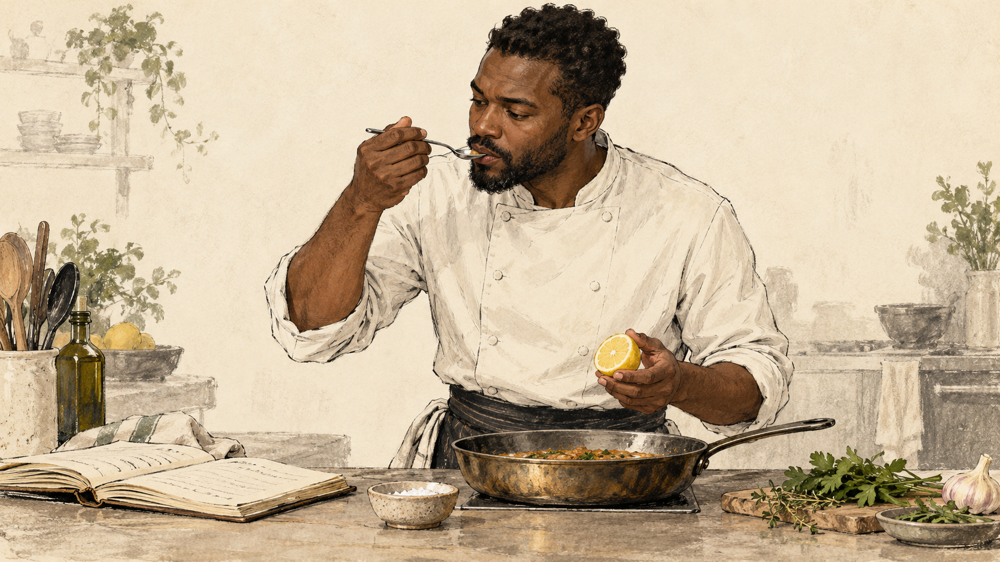

+++
title = "What Is Taste in Software?"
date = 2026-11-01
description = "Taste, creativity, experience, and what we may lose when tools remove the practice that teaches us how to judge good work."
draft = true
[taxonomies]
categories = ["Startups", "Merdra", "AI"]
tags = ["merdra", "startups", "llm"]
+++

While [restyling this site](@/writing/2026-10-31-restyling-this-site-with-codex.md), I kept using phrases like *this feels like too much*, *tone it down*, and *this does not look like my website anymore*.

Those were not technical instructions. I could not always name the CSS responsible, but I could look at the result and decide that it was wrong for what I wanted. It made me ask: What is taste? What drives it? Is it technical or personal? Where do experience and creativity enter?

## What is taste?

Taste is often described as knowing what is good, but that feels incomplete. Good according to whom, and good for what?

I think taste is the ability to notice differences, understand why they matter, and choose what fits a purpose. It is more than liking one colour, meal, design, or programming style over another.

A minimal website is not automatically tasteful. Removing everything is easy; knowing what must remain is harder. The same is true in software: fewer lines are not always better, and a clever abstraction is not always useful.

Taste is partly personal, but it is not random. It can be discussed, criticised, practised, and improved.

## What drives taste?

Experience probably plays a large part, but experience is more than the number of years spent doing something. It is exposure, comparison, failure, feedback, and attention. You try something, see what happens, compare it with other work, and learn what you missed.

What looks like instinct from the outside may be compressed experience.

This is where taste becomes technical. A programmer may sense that an interface will become difficult to maintain. A designer may notice that a page has no hierarchy. A mechanic may hear that an engine is not behaving normally. Their judgment is supported by things they have seen, broken, and repaired before.

Technical knowledge gives taste something to work with. Taste helps decide how and when to use it.

## The chef and the recipe

A recipe gives a chef ingredients, measurements, temperature, and cooking time. An experienced chef still tastes while cooking. They notice that an ingredient is stronger today, the pan is behaving differently, or the food needs acidity rather than more salt.

The chef does not even need to be the person who cooked the meal. By tasting it, they may be able to tell how it was prepared, where the process went wrong, or what is missing. They can judge the result because experience has given them a mental library of ingredients, techniques, and outcomes.

The recipe provides a path. The chef's taste guides the adjustments.

A blender, thermometer, or automatic mixer does not make the chef less skilled. The danger begins when someone can produce meals without ever learning to taste what they are producing. That feels close to the question we now face with AI.

## Can models learn taste?

Fidel Etinosa, who reviewed an early draft of this article, challenged an assumption behind my question: if taste can be taught, why could a model not learn it too?

I think that is possible. Reasoning models are still young, so it would be careless to treat their current limitations as permanent ones.

But if models can learn taste, why do they not already seem to have it? Their training data contains excellent code, design, writing, and criticism. It also contains mediocre work and conflicting ideas about what *good* means.

The model's source code does not contain taste directly; it defines the process through which patterns are learned. A model may learn what experienced people call good without consistently choosing it. Learning a judgment is not the same as preferring it-or, more carefully, behaving consistently as though it prefers it. That may depend on the training objective.

Maybe fragments of taste are already present. The question is whether training can turn those fragments into stable judgment, and whose definition of good that judgment will represent.

But that does not remove the problem I am interested in. A model's taste must still be shaped by some signal: what is rewarded, whose preferences are represented, which contexts it has encountered, and what someone is trying to accomplish.

Even if models develop excellent judgment, humans still need enough judgment to choose the goal, recognise when the model is wrong, and take responsibility for the result.

Maybe the question is not whether AI can learn taste. It is what kind of taste it learns and what happens to ours while it does.

## The Uncle Bob question

While thinking about this, I saw [a post from Robert C. Martin](https://x.com/unclebobmartin/status/2080257779395154409), the author of *Clean Code*. He described not reading the code written by his agents and instead surrounding them with strong constraints: tests, quality metrics, coverage requirements, and other forms of verification.

What interested me was the experience behind the person choosing those constraints.

A recent exchange between [John Carmack](https://x.com/id_aa_carmack/status/2115917666955497608) and [Chris Lattner](https://x.com/clattner_llvm/status/2116268356160667775) made this more concrete for me. Good building blocks and abstractions still matter, even when an agent writes the implementation. AI may explain the available trade-offs, but the remaining decision still belongs to someone. Perhaps recognising the important decision—and accepting responsibility for it—is part of technical taste.

An [Anthropic team recently shared a practical example](https://x.com/somi_ai/status/2116050219989373170/video/1). They rewrote a Python API in Rust without having a Rust developer in the room. Claude wrote much of the implementation, while the humans designed the distributed system, planned the migration, and verified it by sending shadow traffic through both versions. Their expertise did not disappear; it moved from writing each line to defining the system and deciding what evidence would make it trustworthy.

That leaves the same question: if experience helps produce taste, can someone without it safely copy the workflow of someone who already has it?

Making work easier is not the problem. Removing the feedback loops through which people learn might be. We see what an experienced person can stop doing but ignore what they had to do before they could stop. We should automate repetition without automatically removing practice.

## Manual and automatic cars

You do not need to drive a manual car to be a good driver. An automatic transmission removes work and makes driving accessible to more people.

But a manual car exposes part of the machine's behaviour. You feel the relationship between the engine, gears, speed, and movement. That does not make every manual driver a mechanic, but it provides feedback that an automatic system normally hides.

The lesson is not that everyone must suffer through the old way. It is that an abstraction may remove information along with effort. We need to know which information still matters and find another way to teach it.

## Where creativity enters

Creativity and taste are related, but they are not the same.

Creativity generates possibilities. Taste chooses among them, combines them, and knows when to stop. Creativity asks, *what else could this be?* Taste asks, *which version belongs here?*

Problem-solving needs both. We frame the problem, generate possible solutions, test them, and refine what survives. Technical knowledge tells us what is possible. Creativity helps us escape the obvious answer. Taste helps us recognise the answer that fits.

Without creativity, taste can only criticise. Without taste, creativity can produce endlessly without knowing what deserves to remain.

## What are we building towards?

I do not think anyone can confidently predict what the future will look like. We are building towards what we think it should be, and our tools will shape the people using them.

I do not think [Anthropic](https://www.anthropic.com/), [OpenAI](https://openai.com/), [Google DeepMind](https://deepmind.google/), or anyone else building in this space can confidently predict that future either, even if their work is helping to usher in and shape a particular version of it.

The question may not be whether AI can do more of the work. It clearly can. The question is whether people will still develop the judgment needed to direct, evaluate, and take responsibility for that work.

I have a similar feeling when dealing with some non-critical, well-contained parts of [Merdra](https://www.merdra.com/). I do not need to hold every line in my head, but I need to understand what the system is doing and keep a mental map of it: how the parts relate, what assumptions they depend on, and where to look when something changes.

That distinction matters. Security, patient data, clinical safety, and other critical paths require much closer understanding and stronger verification. Abstraction may reduce how much code I read directly; it cannot remove my responsibility for knowing how those parts behave.

Maybe that is another form of taste: knowing how much detail can be abstracted away without surrendering understanding or responsibility.

These are questions without specific answers, at least for now.


Thanks to **Rtrvl (CTO)** and **Fidel Etinosa** for reviewing an early draft of this article.


