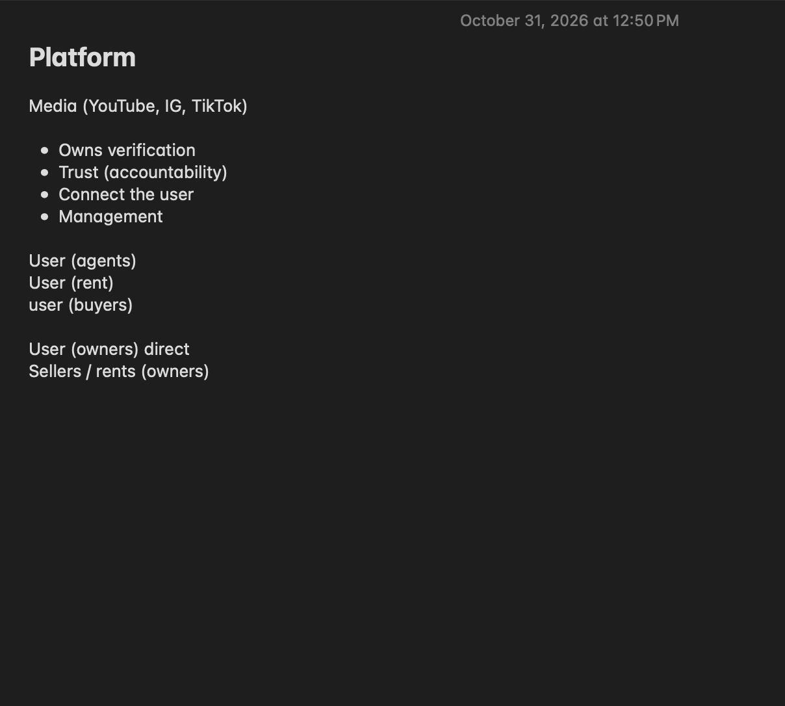

+++
title = "Thinking with AI"
date = 2026-11-04
description = "AI lets us delegate more of the work. How do we preserve the experiences that teach us to judge the result?"
draft = true

[taxonomies]
categories = ["AI"]
tags = []
+++

After publishing [Taste in Software](https://daveads.github.io/writing/taste-in-software/), I read Addy Osmani's [Critical thinking when agents do the work](https://x.com/addyosmani/status/2117512471930167377).

He describes how delegating a task can gradually become accepting an answer without examining it. Two of his suggestions felt familiar: form an initial hypothesis before asking, and seek counterarguments from different models.

Those are things I already find myself doing. His article helped me understand why I want to keep doing them. It also left me with a question: if we increasingly ask humans to direct agents and judge their work, how do those humans learn to judge?

## Writing gives me something to question

A small example is a note I was making for someone in real estate. It was basic: a list of the people a property platform would connect, including agents, renters, buyers, and owners. I wrote down responsibilities such as verification, trust, accountability, and management.

I needed to write it because I was still trying to think through the idea. Putting the pieces on the page gave me something I could rearrange and question.

That sketch was not yet a testable hypothesis, but it helped me move towards one. Perhaps people would choose the platform because it takes responsibility for verification. What would make them trust those checks? Who would be accountable when something goes wrong? What evidence would show that this matters to them?

I can explore those questions with a model, then test the assumptions with people in the market. Writing first gives me an initial position that can change. Otherwise, I may spend the whole exchange reacting to a polished proposal without making my own assumptions explicit.

## Thinking with different models

Addy also describes asking more than one model to argue the opposite side of an open-ended question, then reviewing the arguments and forming his own opinion.

I recognise that in my conversations with Grok, Codex, and Claude. Moving an idea between them gives me opportunities to encounter an objection or framing I had not considered.

For the real estate idea, I could ask why owners and agents might avoid the platform, or how its incentives could undermine the trust it promises to provide.

Several models can still share the same weak assumption. Their agreement does not establish that an idea will work, and a persuasive objection still needs examination. I have to decide which arguments matter and what evidence would change my position.

The useful part is leaving the exchange better able to explain what I think and why.

## The experience behind the workflow

An experienced engineer might delegate an implementation, choose a few important checks, and approve the result. Someone watching can copy those steps without understanding why those checks were chosen.

In my earlier article, I wrote:

> We see what an experienced person can stop doing but ignore what they had to do before they could stop.

Consider a background job that sends an email. A request times out, so an agent adds a retry and a test showing that a failed attempt is followed by a successful one. Everything passes.

But the service may have accepted the first email before its response was lost. Retrying could send it twice. The test checked the behaviour we requested while leaving that possibility unexamined.

Someone has to notice the assumption. They might learn to recognise it through a mentor, documentation, an experiment, or a previous failure. Copying a workflow does not automatically transfer that experience.

## Keeping room for practice

Practice can change as the tools improve. I do not think everyone needs to repeat the exact path taken by earlier generations of programmers. I want to know which lessons still matter and how a new workflow can teach them.

Before running generated code, I could predict its behaviour for a few inputs. After reading an explanation, I could close it and apply the idea to a different case. When an agent fixes a bug, I could reproduce the failure and work through why the change addresses it.

An agent can help with these exercises and suggest assumptions I missed. I still need opportunities to discover where my understanding falls short.

Teams need to make time for that learning too. If every task rewards the quickest delivery, investigating an unfamiliar part of a system becomes difficult to justify. Yet we may later expect the same person to diagnose failures and review important changes.

For me, writing before asking is one way to stay involved. Taking an idea to different models is another, provided I examine their arguments and seek evidence beyond their responses.

I want to leave an exchange able to say what changed in my understanding, and why. If human judgment is going to remain part of the workflow, people need room to develop it while the work is getting done.


While writing this, I also read a few of Addy’s other articles. See [November Reads](@/note/2026-11-04-Nov-reads.md).

